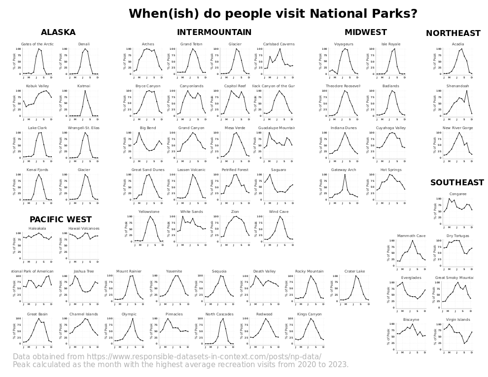

```{r}
#| echo: false 
#| warning: false 
#| message: false

library(tidyverse)
library(ggplot2)
library(glue)
library(gganimate)

# format: 
#   html: 
#     code-fold: true
#     reference-location: margin
#     citation-location: margin
```

As part of [2025 International Love Data Week](https://www.icpsr.umich.edu/web/about/cms/3799), I participated in the [Northwestern Visualization Contest](https://www.northwestern.edu/provost/about/ir/love-data/2025/data-viz-championship.html).

:::{.callout-note appearance="simple"}
About a year later I tried plotting using different visualizations with `Sveltplot` [here](https://mika-long.github.io/vis-gallery/national-park/).
:::

```{r}
#| code-fold: true 
# set custom theme 
# selected_months <- c("Jan", "Mar", "Jun", "Sep", "Dec")
selected_months <- c("J", "M", "J", "S", "D")

# define the custom theme 
theme_custom <- function(base_size = 14) {
  theme_minimal(base_size = base_size) +
    theme(
      # Text elements
      axis.text.x = element_text(size = rel(1.1), color = "gray20", family = "Roboto", face="bold"),
      axis.text.y = element_text(size = rel(1.1), color = "gray20", family = "Roboto", face="bold"),
      axis.title = element_text(size = rel(1.2), color = "gray20", family= "Roboto"),
       plot.title = element_text(
        size = rel(1.3), 
        color = "gray20",
        hjust = 0.5,  # This centers the title
        family = "Roboto"
      ),
      
      # Grid customization
      panel.grid.minor = element_blank(),
      panel.grid.major.y = element_line(
        color = "gray85",
        linetype = "dashed",
        linewidth = 0.3
      ),
      panel.grid.major.x = element_line(
        color = "gray85",
        linetype = "dashed",
        linewidth = 0.3
      ),
      
      # Clean borders
      axis.line = element_line(color = "gray20", linewidth = 0.3),
      
      # Remove background elements
      panel.background = element_blank(),
      plot.background = element_blank()
    )
}

theme_set(theme_custom())
```

# When(-ish) do people visit national parks? 

We first load the data obtained from https://www.responsible-datasets-in-context.com/posts/np-data. 

<!-- First we load the data^[which was obtained from /?tab=explore-the-data]. The file is not quite ready to be merged with other ones, so we make changes to it.   -->

<!-- Ok then there is the `geojson` file obtained from [here](https://catalog.data.gov/dataset/national-parks-c0904/resource/3ddcf942-ddf1-4e3d-9d70-0432b6029f45). The national park service apparently also have their own javascript [here](https://home1.nps.gov/maps/tools/npmap.js/examples/basic/).  -->

```{r}
df <- read.csv(file = "US-National-Parks_Use_1979-2023_By-Month.csv") %>% 
  tibble(.) %>% 
  mutate(ParkName = str_remove(ParkName, "NP.*$")) |>
  mutate(ParkName = trimws(ParkName)) %>% 
  mutate(Region = trimws(Region))

knitr::kable(head(df))
```

My first attempt was to plot a small multiples plot of the monthly average `RecreationVisits` to see what the general trend looks like: 

```{r}
#| warning: false 
#| fig-column: page-right
#| fig-width: 10
#| fig-height: 10

df %>% select(UnitCode, Year, Month, RecreationVisits) %>%
  group_by(UnitCode, Month) %>% 
  summarise(avg_rec_visits = round(mean(RecreationVisits))) %>% 
  ggplot(aes(x = Month, y = avg_rec_visits)) + 
  geom_line() + 
  facet_wrap(~UnitCode) + 
  scale_x_continuous(breaks = 1:12, labels = 1:12) + 
  scale_y_continuous(labels = function(x) paste0(x/1000, "K")) + 
  theme_custom()
```

Clearly some of the really popular national parks (such as Yellow Stone `YELL`, Yosemite `YOSE`) have average monthly visits on a entirely different scale than some of the other national parks. To plot seasonal patterns better, we could first calculate the average monthly visits, then "scale" the monthly visits to be percentage of the maximum average monthly visit. 

```{r}
#| warning: false 
#| fig-column: page-right
#| fig-width: 10
#| fig-height: 10

df %>% select(UnitCode, Year, Month, RecreationVisits) %>%
  group_by(UnitCode, Month) %>% 
  summarise(avg_rec_visits = round(mean(RecreationVisits))) %>% 
  group_by(UnitCode) %>% 
  mutate(pct_of_max = avg_rec_visits / max(avg_rec_visits)) %>% 
  ggplot(aes(x = Month, y = pct_of_max)) + 
  geom_line() + 
  facet_wrap(~UnitCode) + 
  scale_x_continuous(breaks = 1:12, labels = 1:12) + 
  theme_custom()
```

:::{.column-margin}
A part of me wants to create a [joy plot/ridge line](https://observablehq.com/@d3/ridgeline-plot) version of this graph but that's a challenge for later after I figure out how to use `OJS` with `Quarto`...  
:::

This graph gives a better sense of what are the seasonal variations in visit patterns across national parks. But it also glosses over a lot of details happening over the years. That's when I thought maybe an animated version of the monthly visit data across the years could be something cool to try out. 

## Animating things 

First, if we were to plot everything out all at once, what would it look like? 

```{r}
#| column: page
#| warning: false 
#| fig-column: page-right
#| fig-height: 10
#| fig-width: 10

df %>%
  ggplot(aes(x = Month, y = RecreationVisits, color = Year, group = Year)) +
  geom_line() +
  facet_wrap(~UnitCode) +
  scale_x_continuous(breaks = 1:12, labels = 1:12) +
  scale_color_viridis_c() + 
  theme_custom()
```

We can make it animated by using the [`gganimate`](https://gganimate.com/) package. Let's first start with a single national park, say Acadia `ACAD`: 

```{r}
#| warning: false 
#| cache: true 

df %>% filter(ParkName == "Acadia") %>%
  ggplot(aes(x = Month, y = RecreationVisits, color = Year, group = Year)) +
  geom_line(linewidth=1.5) +
  scale_color_viridis_c()+
  scale_x_continuous(breaks = 1:12, labels = 1:12) +
  scale_y_continuous(labels = function(x) paste0(x/1000, "K")) +
  labs(title = 'Year: {frame_time}') +
  transition_time(Year) +
  shadow_mark(past = T, future = F, alpha = 0.1) + 
  theme_custom()
```

We can also do this for the entire set of national parks: 

```{r}
#| warning: false 
#| cache: true 


df %>%
  ggplot(aes(x = Month, y = RecreationVisits, color = Year, group = Year)) +
  geom_line() +
  facet_wrap(~UnitCode) +
  scale_x_continuous(breaks = 1:12, labels = 1:12) +
  scale_color_viridis_c() +
  scale_y_continuous(labels = function(x) paste0(x/1000, "K")) +
  labs(title = 'Year: {frame_time}') +
  transition_time(Year) +
  shadow_mark(past = T, future = F, alpha = 0.1) + 
  theme_custom()
```

:::{.column-margin}
There are a lot of things happening at the same time ... What if I want to identify outliers? What if I want to know whether geographically close national parks are going to have similar visitation patterns? This is why I built the [interactive](https://mika-long.github.io/national_park/) version. 
:::

## Final submission 

:::{.column-page-inset}

:::

<!-- # Conclusions 

The national park services provide a rich set of publicly available data and interesting APIs. One could stay in the relam of `R` and use packages like [`leaflet`](https://rstudio.github.io/leaflet/) to plot things like locations of national parks. The National Park Service also has its official [API](https://www.nps.gov/subjects/developer/guides.htm) as well as tools that allow for map making ([NPMap.js](https://home1.nps.gov/maps/tools/npmap.js/)) and even icons designed specifically for NPS^[https://github.com/nationalparkservice/symbol-library]? I am very pleasantly surprised to have found all this information.   -->


